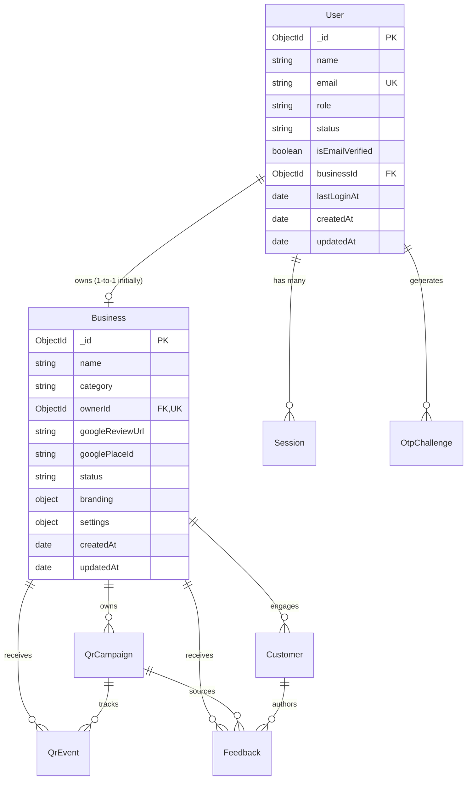

# Database Design & Architecture Specifications

This document outlines the database conventions, schemas, indexes, and multi-tenant isolation patterns for the Review Management SaaS platform.

---

## 1. Core Conventions & Standards

- **ODM**: Mongoose with TypeScript strict type definitions.
- **Timestamps**: All schemas enable `{ timestamps: true }`, automatically managing `createdAt` and `updatedAt`.
- **Transformation**: `toJSON` transforms remove Mongoose internal revision keys (`__v`).
- **Schema Strictness**: `{ strict: true }` prevents unindexed, unexpected fields from polluting documents.
- **Normalization**:
  - Email addresses are always converted to lowercase, trimmed, and validated against RFC regex.
  - Names, titles, URLs, and slugs are trimmed of extraneous whitespace.
- **Transactions Notice**: Multi-document ACID transactions (planned for Phase 3 signup atomicity) **require a MongoDB Replica Set** (such as MongoDB Atlas or local `mongod --replSet rs0`). They are not supported on standalone uninitialized local mongod servers.

---

## 2. Multi-Tenant Partitioning Model

The platform is designed around a **Single-Database, Shared-Schema, Multi-Tenant Architecture**:

1. **Root Tenant Entity**: The `Business` collection represents the tenant boundary. Every business account initially corresponds to one business location.
2. **Tenant Scoping Key (`businessId`)**:
   - All subsequent tenant-owned entities (e.g. `Customer`, `Feedback`, `QrCampaign`, `Subscription`, `QrEvent`) will store an indexed `businessId: Schema.Types.ObjectId` referencing their respective `Business` document.
3. **Strict Query Isolation**:
   - Backend queries for tenant data must never accept a client-provided `businessId` without server-side session authorization.
   - All tenant read and write queries enforce `{ businessId: req.session.businessId }` at the service layer.

---

## 3. Schemas & Relationships

### A. User Collection (`users`)

Represents human actors on the platform, including business owners and platform super administrators.

#### Schema Fields:
| Field | Type | Required | Default | Description |
| :--- | :--- | :---: | :---: | :--- |
| `_id` | `ObjectId` | Auto | Auto | Unique document identifier |
| `name` | `String` | Yes | — | Full name of user/owner (2-100 characters) |
| `email` | `String` | Yes | — | Normalized lowercase, unique email address |
| `role` | `String` | Yes | `'business_owner'` | Role enum: `'business_owner'`, `'super_admin'` |
| `status` | `String` | Yes | `'pending'` | Account status: `'pending'`, `'active'`, `'suspended'` |
| `isEmailVerified`| `Boolean` | Yes | `false` | Verification state via OTP |
| `businessId` | `ObjectId` | No | `null` | Reference to the associated `Business` |
| `lastLoginAt` | `Date` | No | `null` | Timestamp of last successful session creation |
| `createdAt` | `Date` | Auto | Auto | Document creation timestamp |
| `updatedAt` | `Date` | Auto | Auto | Document modification timestamp |

#### Indexes:
- `{ email: 1 }` (Unique): Prevents duplicate account registrations.
- `{ role: 1, status: 1 }` (Compound): Optimizes Super Admin filtering for active/suspended owners.
- `{ email: 1, isEmailVerified: 1 }` (Compound): Accelerates OTP challenge and login verification.
- `{ businessId: 1 }`: Enables fast resolution of the user's tenant context.

---

### B. Business Collection (`businesses`)

Represents the business profile, public branding configuration, and review routing preferences.

#### Schema Fields:
| Field | Type | Required | Default | Description |
| :--- | :--- | :---: | :---: | :--- |
| `_id` | `ObjectId` | Auto | Auto | Unique business identifier (acts as the primary `businessId`) |
| `name` | `String` | Yes | — | Registered trade name of the business (2-120 chars) |
| `category` | `String` | Yes | — | Business category (e.g. "Restaurant", "Clinic", "Retail") |
| `ownerId` | `ObjectId` | Yes | — | Reference to `User._id`. Unique (1 location per owner initially) |
| `googleReviewUrl` | `String` | No | `null` | Direct Google Business review link |
| `googlePlaceId` | `String` | No | `null` | Google Maps Place ID for API integrations |
| `status` | `String` | Yes | `'active'` | Status enum: `'active'`, `'suspended'`, `'pending_verification'` |
| `branding.logoUrl` | `String` | No | `null` | URL/Path to safe uploaded logo image |
| `branding.primaryColor`| `String` | Yes | `'#2563EB'` | Brand primary hex color |
| `branding.secondaryColor`| `String` | Yes | `'#1E293B'` | Brand secondary hex color |
| `settings.allowPublicReviews`| `Boolean`| Yes | `true` | Platform policy compliance flag |
| `settings.notificationEmail`| `String` | No | `null` | Optional notification routing email |
| `settings.defaultLanguage`| `String` | Yes | `'en'` | Feedback landing page default language |
| `settings.headingText`| `String` | No | `null` | Custom landing-page heading (max 120 chars) |
| `settings.subheadingText`| `String` | No | `null` | Custom landing-page subtitle (max 250 chars) |
| `createdAt` | `Date` | Auto | Auto | Document creation timestamp |
| `updatedAt` | `Date` | Auto | Auto | Document modification timestamp |

#### Indexes:
- `{ ownerId: 1 }` (Unique): Enforces one business per owner account for single-location architecture.
- `{ status: 1, createdAt: -1 }` (Compound): Super Admin chronological list filtering.
- `{ category: 1, status: 1 }` (Compound): Facilitates platform analytics by business vertical.
- `{ name: 1 }`: Accelerates administrative search by business name.

---

### C. OtpChallenge Collection (`otpchallenges`)

Stores short-lived cryptographic challenge states for email OTP verification.

#### Schema Fields:
| Field | Type | Required | Default | Description |
| :--- | :--- | :---: | :---: | :--- |
| `_id` | `ObjectId` | Auto | Auto | Unique challenge identifier |
| `email` | `String` | Yes | — | Normalized lowercase target email address |
| `purpose` | `String` | Yes | — | Challenge purpose: `'signup'`, `'login'` |
| `otpHash` | `String` | Yes | — | Keyed HMAC-SHA256 hash of the 6-digit OTP |
| `expiresAt` | `Date` | Yes | — | Expiration timestamp (MongoDB TTL index) |
| `attempts` | `Number` | Yes | `0` | Verification attempt counter |
| `maxAttempts` | `Number` | Yes | `3` | Maximum allowed attempts before invalidation |
| `isConsumed` | `Boolean` | Yes | `false` | Single-use flag preventing replay |
| `consumedAt` | `Date` | No | `null` | Consumption timestamp |
| `metadata` | `Object` | No | `null` | Pre-validated registration data for signup |
| `createdAt` | `Date` | Auto | Auto | Challenge generation timestamp |
| `updatedAt` | `Date` | Auto | Auto | Document modification timestamp |

#### Indexes:
- `{ expiresAt: 1 }` (TTL): Automatic deletion after expiry.
- `{ email: 1, purpose: 1, isConsumed: 1 }` (Compound): Rapid active challenge retrieval.
- `{ email: 1, createdAt: -1 }` (Compound): Resend cooldown calculations.

---

### D. Session Collection (`sessions`)

Stores persistent authentication sessions for secure cookie authentication.

#### Schema Fields:
| Field | Type | Required | Default | Description |
| :--- | :--- | :---: | :---: | :--- |
| `_id` | `ObjectId` | Auto | Auto | Unique session identifier |
| `userId` | `ObjectId` | Yes | — | Reference to `User._id` |
| `tokenHash` | `String` | Yes | — | HMAC-SHA256 hash of the 64-char session token |
| `expiresAt` | `Date` | Yes | — | Expiration timestamp (MongoDB TTL index) |
| `isRevoked` | `Boolean` | Yes | `false` | Explicit revocation status |
| `revokedAt` | `Date` | No | `null` | Revocation timestamp |
| `userAgent` | `String` | No | `null` | Client browser user agent |
| `ipAddress` | `String` | No | `null` | Client IP address |
| `createdAt` | `Date` | Auto | Auto | Session creation timestamp |
| `updatedAt` | `Date` | Auto | Auto | Document modification timestamp |

#### Indexes:
- `{ tokenHash: 1 }` (Unique): O(1) lookup during authentication.
- `{ expiresAt: 1 }` (TTL): Automatic purge of expired sessions.
- `{ userId: 1, isRevoked: 1, expiresAt: 1 }` (Compound): Fast resolution and bulk logout.

---

### E. QR Campaign Collection (`qrcampaigns`)

Represents customizable, trackable physical/digital QR campaigns owned by a business tenant.

#### Schema Fields:
| Field | Type | Required | Default | Description |
| :--- | :--- | :---: | :---: | :--- |
| `_id` | `ObjectId` | Auto | Auto | Unique campaign document identifier |
| `businessId` | `ObjectId` | Yes | — | Tenant reference to owning `Business` |
| `title` | `String` | Yes | — | Internal campaign title (e.g. "Table Tent 4") |
| `heading` | `String` | Yes | — | Public landing customer greeting |
| `description` | `String` | No | `null` | Optional customer supporting text |
| `branding.primaryColor` | `String` | Yes | `'#2563EB'` | Validated hex brand accent / QR foreground |
| `branding.backgroundColor`| `String` | Yes | `'#FFFFFF'` | Validated hex QR background |
| `branding.logoKey` | `String` | No | `null` | Server-assigned storage key |
| `branding.logoUrl` | `String` | No | `null` | Fully qualified public logo CDN/file URL |
| `status` | `String` | Yes | `'active'` | `'active'` or `'inactive'` |
| `publicToken` | `String` | Yes | — | Cryptographically random unique 24-character token |
| `scanCount` | `Number` | Yes | `0` | Atomic scan event counter |
| `createdAt` | `Date` | Auto | Auto | Document creation timestamp |
| `updatedAt` | `Date` | Auto | Auto | Document modification timestamp |

#### Indexes:
- `{ publicToken: 1 }` (Unique): O(1) public resolution without revealing internal database IDs.
- `{ businessId: 1, status: 1 }` (Compound): Accelerates tenant-scoped list queries filtered by active status.
- `{ businessId: 1, createdAt: -1 }` (Compound): Optimizes tenant campaign pagination and stable sorting.

---

### F. QR Scan Event Collection (`qrevents`)

Records privacy-conscious telemetry whenever a customer scans a physical QR code.

#### Schema Fields:
| Field | Type | Required | Default | Description |
| :--- | :--- | :---: | :---: | :--- |
| `_id` | `ObjectId` | Auto | Auto | Unique event identifier |
| `campaignId` | `ObjectId` | Yes | — | Reference to `QrCampaign` |
| `businessId` | `ObjectId` | Yes | — | Reference to owning `Business` |
| `eventType` | `String` | Yes | `'scan'` | Event type indicator |
| `metadata.referrer` | `String` | No | `null` | Truncated referrer header (max 200 chars) |
| `metadata.language` | `String` | No | `null` | Truncated language header (max 10 chars) |
| `createdAt` | `Date` | Auto | Auto | Timestamp of scan |
| `updatedAt` | `Date` | Auto | Auto | Timestamp of event creation |

> **Privacy Note**: To protect customer privacy and comply with GDPR/CCPA principles, `QrEvent` does **NOT** store raw IP addresses, browser fingerprint hashes, customer names, or tracking cookies.

#### Indexes:
- `{ campaignId: 1, createdAt: -1 }` (Compound): Accelerates per-campaign time-series scan analytics.
- `{ businessId: 1, createdAt: -1 }` (Compound): Accelerates business-wide aggregate reporting.

---

### G. Customer Collection (`customers`)

Represents end-customer profiles associated with a business tenant. Created and updated across visits without exposing private data.

#### Schema Fields:
| Field | Type | Required | Default | Description |
| :--- | :--- | :---: | :---: | :--- |
| `_id` | `ObjectId` | Auto | Auto | Unique customer identifier |
| `businessId` | `ObjectId` | Yes | — | Tenant reference to owning `Business` |
| `name` | `String` | Yes | — | Customer display name (2-100 characters) |
| `email` | `String` | No | `null` | Normalized lowercase email address |
| `phone` | `String` | No | `null` | Normalized contact phone number |
| `lastVisitedAt` | `Date` | Yes | `Date.now` | Timestamp of most recent visit/feedback |
| `createdAt` | `Date` | Auto | Auto | First recorded interaction timestamp |
| `updatedAt` | `Date` | Auto | Auto | Most recent record update timestamp |

#### Indexes:
- `{ businessId: 1, email: 1 }`: Fast customer resolution by email within a business tenant.
- `{ businessId: 1, phone: 1 }`: Fast customer resolution by phone within a business tenant.
- `{ businessId: 1, createdAt: -1 }`: Optimizes customer listing and recency ordering.

---

### H. Feedback Collection (`feedbacks`)

Stores customer feedback submissions, ratings, and business question responses.

#### Schema Fields:
| Field | Type | Required | Default | Description |
| :--- | :--- | :---: | :---: | :--- |
| `_id` | `ObjectId` | Auto | Auto | Unique feedback identifier |
| `businessId` | `ObjectId` | Yes | — | Tenant reference to owning `Business` |
| `qrCampaignId` | `ObjectId` | Yes | — | Reference to originating `QrCampaign` |
| `customerId` | `ObjectId` | Yes | — | Reference to `Customer` |
| `rating` | `Number` | Yes | — | Star rating between 1 and 5 |
| `text` | `String` | No | `null` | Authentic written customer experience (max 2000 chars) |
| `answers` | `Array` | Yes | `[]` | Array of validated question responses |
| `status` | `String` | Yes | `'new'` | Internal workflow: `'new'`, `'reviewed'`, `'resolved'` |
| `consentAccepted` | `Boolean` | Yes | — | Explicit customer consent acknowledgment |
| `createdAt` | `Date` | Auto | Auto | Submission timestamp |
| `updatedAt` | `Date` | Auto | Auto | Status modification timestamp |

#### Indexes:
- `{ businessId: 1, createdAt: -1 }`: Optimizes internal feedback inbox pagination.
- `{ businessId: 1, status: 1, createdAt: -1 }`: Fast filtering by workflow status.
- `{ businessId: 1, rating: 1 }`: Fast filtering by star rating.
- `{ qrCampaignId: 1, createdAt: -1 }`: Campaign-specific feedback resolution.

---

## 4. Relationship Diagram



---

## 5. Development & Production Setup Instructions

### Connecting to Local MongoDB

1. **Option A: macOS Homebrew Service**:
   ```bash
   brew tap mongodb/brew
   brew install mongodb-community
   brew services start mongodb-community
   ```
2. **Option B: Docker**:
   ```bash
   docker run -d -p 27017:27017 --name review-saas-mongo mongo:latest
   ```
3. Set your `.env` connection string:
   ```env
   MONGODB_URI=mongodb://localhost:27017/review_saas
   ```

### Connecting to MongoDB Atlas (Cloud)

1. Create a cluster on [MongoDB Atlas](https://www.mongodb.com/cloud/atlas).
2. Create a database user with Read/Write privileges.
3. Whitelist your current IP address under **Network Access**.
4. Copy the connection string into `backend/.env`:
   ```env
   MONGODB_URI=mongodb+srv://<username>:<password>@<cluster>.mongodb.net/review_saas?retryWrites=true&w=majority
   ```
   *Note: Our connection utility automatically masks credentials when logging (`mongodb+srv://<username>:*****@...`) so credentials will never appear in application logs.*
